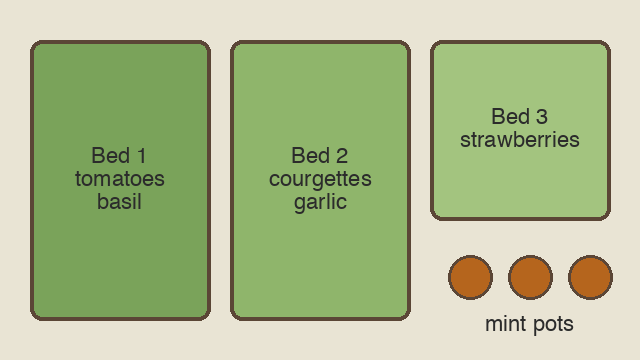

# Garden Plan

What goes where this year. #garden

## Beds

- **Bed 1**: [[tomatoes]] with [[basil]] in between, see [[companion-planting]]
- **Bed 2**: [[courgettes]] and [[garlic]]
- **Bed 3**: [[strawberries]], on a bed of straw ([[mulching]])
- **Pots**: [[mint]], kept apart so it doesn't take over

## Jobs

- Turn the [[composting|compost heap]] every two weeks
- Stick to the [[watering]] schedule
- Plan next year's [[crop-rotation]]
- Build a small [[greenhouse]]
